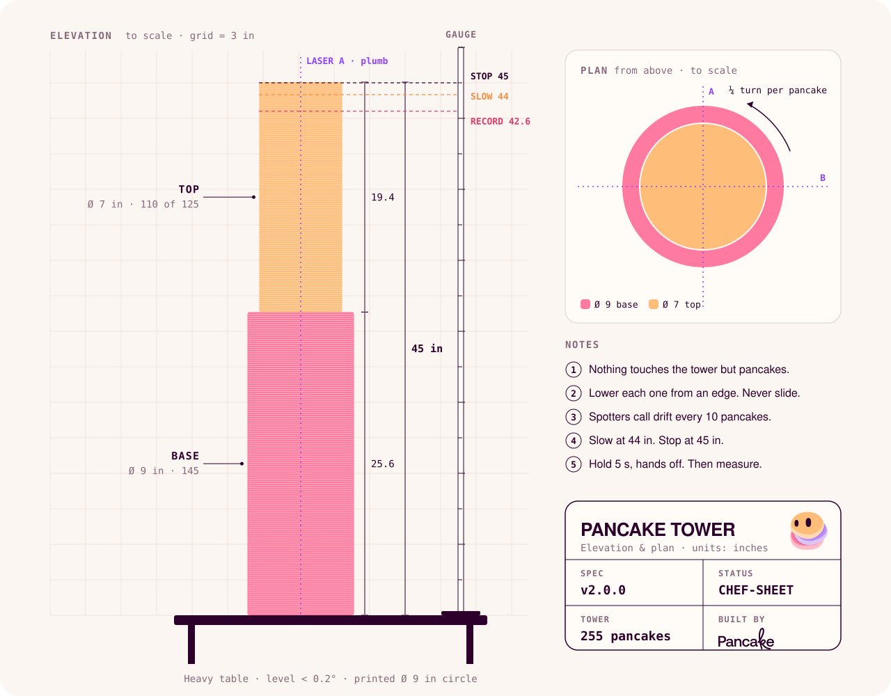
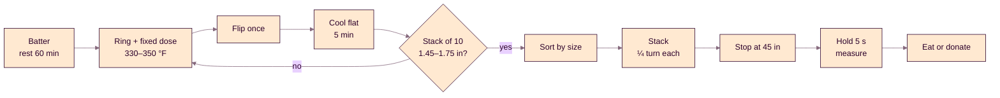
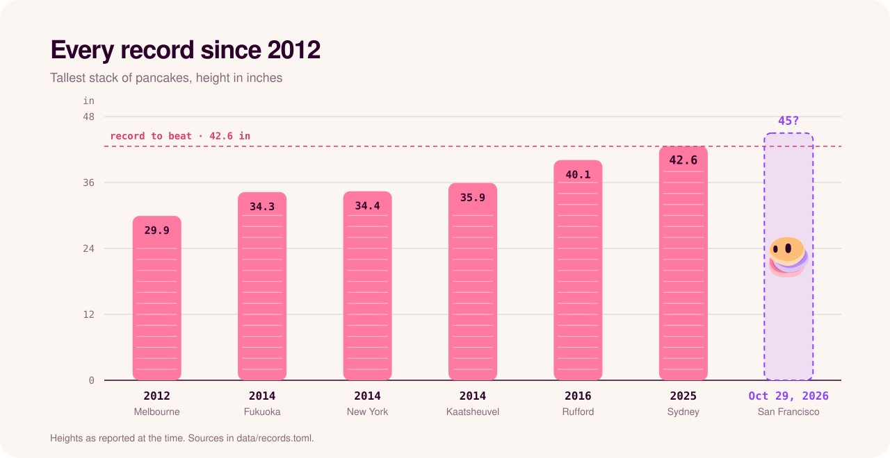

<p align="center">
  
</p>

<p align="center">
  
  
  
  
  
  <a href="../../actions/workflows/spec-check.yml"></a>
</p>

<p align="center">
  <a href="https://get-pancake.github.io/pancake-tower/"><b>The page</b></a> ·
  <a href="RECIPE.md">Recipe</a> ·
  <a href="STACKING.md">Build protocol</a> ·
  <a href="#calculator">Calculator</a> ·
  <a href="RULES.md">Rules</a> ·
  <a href="TESTLOG.md">Test log</a>
</p>

## The promise

Pancake hit #1 Product of the Day on Product Hunt on Oct 14, 2026. We'd promised a world record if it did.

So on Oct 29 we stack pancakes in San Francisco, live. Everything we know goes here first: the recipe, the build protocol, the math. Copy it. Beat us.

> [!IMPORTANT]
> **v0.1.0 is untested.** These are engineering estimates. Measured numbers replace them after our rehearsal, in [TESTLOG.md](TESTLOG.md).

## The numbers

| | |
|---|---|
| Height to beat | **42.6 in** · 108.3 cm · 230 pancakes · Sydney, 2025 |
| We stop at | **45 in**, then hands off |
| Must stand | **5 s**, freestanding |
| Pancakes in the tower | **~300**, in three sizes: 9, 8 and 6 in |
| Each pancake | **0.16 in** cooked. The rule allows 0.39 in |
| To cook | **390** pancakes, 10.3 gal of batter |

## The tower

<p align="center">
  
</p>

Drawn to scale from [`recipe.toml`](recipe.toml) by [`tools/render.py`](tools/render.py). Change a number, re-run it, and the drawing follows.

## How we stack it

- **Thin and dense.** Fluffy pancakes compress unpredictably. Ours carry weight.
- **Same dose, same ring, every time.** Volume comes from a dispenser, not a ladle and a guess.
- **A three-step pyramid.** Less load on the bottom. More room for a shaky hand.
- **Nothing touches the tower but pancakes.** No rings, no rods, no syrup between layers. Lasers and a freestanding gauge read plumb and height.
- **Stop on height, not on count.** Thickness drifts. The 45 in line doesn't.

## From batter to plate



## Calculator

```bash
python3 calc.py                  # one tower + 30% spares
python3 calc.py --attempts 2     # cook for a second attempt
python3 calc.py --thickness 0.15 # re-plan with your measured thickness
python3 calc.py --check          # fail if the spec breaks a rule
```

<details>
<summary>Sample output</summary>

| Size | Ring | In tower | To cook | Batter per pancake |
|---|---|---|---|---|
| base | 9 in | 50 | 65 | 4.4 fl oz (130 ml) |
| body | 8 in | 200 | 260 | 3.5 fl oz (103 ml) |
| top | 6 in | 50 | 65 | 2.0 fl oz (58 ml) |
| **total** | | **300** | **390** | |

Shopping list for one attempt: 37 lb 6 oz flour, 5.2 gal whole milk, 85 large eggs, 1 lb 8 oz sugar, 9 oz salt, 3 oz baking powder, 12 oz neutral oil.

</details>

The [page](https://get-pancake.github.io/pancake-tower/) runs the same math in your browser.

## The record so far

<p align="center">
  
</p>

## What's in here

```
recipe.toml        the spec. Every number lives here
calc.py            cooking plan, shopping list, height check
RECIPE.md          batter, cooking, quality control
STACKING.md        geometry, roles, build protocol
RULES.md           the record rules, and what we're confirming
TESTLOG.md         measured numbers that replace our guesses
data/records.toml  record history, with sources
tools/render.py    draws assets/*.svg and docs/spec.json from the spec
docs/              the page
```

## Run your own attempt

Fork it, cook it, measure it. Then [report your attempt](../../issues/new?template=attempt-report.yml) or [suggest a recipe variant](../../issues/new?template=recipe-variant.yml). Better numbers win.

`git push --syrup`

## About Pancake


**Pancake gives your agent the brain, the data and the tools to run your go-to-market.**
[pancake.ai](https://pancake.ai)

<br clear="left">

## License

Code: MIT. Docs and recipe: CC BY 4.0. The Pancake name, logo and mascot belong to Pancake and aren't covered by either license. See [LICENSE](LICENSE).
